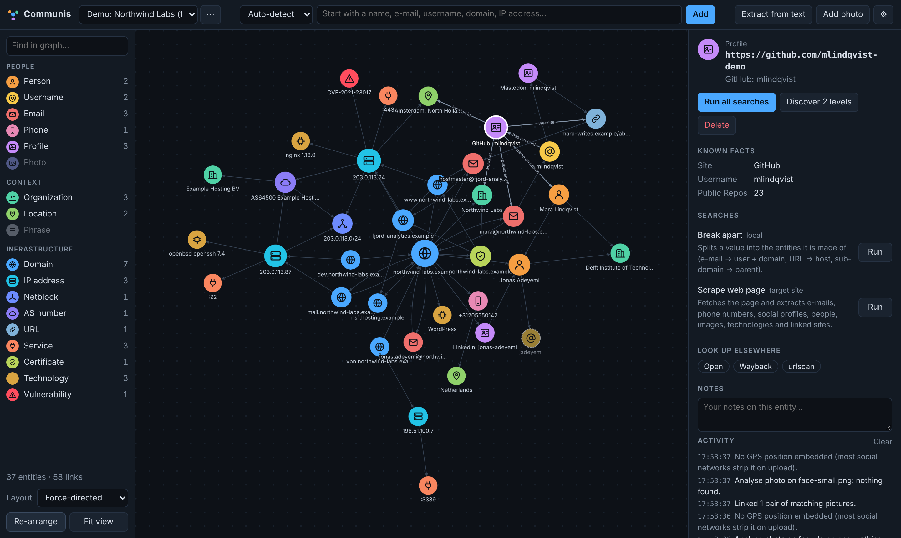

# Communis

A graphical OSINT link-analysis tool. Start from one thing you know (a name, e-mail, username, photo,
domain, IP address), run searches on it, and every result becomes a node in a graph. An entity that turns
up from several directions is the same node, so connections between people, accounts and infrastructure
appear on their own.



## Run it

Requires Node.js 20 or newer.

```bash
npm install
npm start
```

Then open http://127.0.0.1:4780. Click **load the demo graph** on the empty screen for a fictional example.

Options (environment variables): `PORT`, `HOST` (default `127.0.0.1`), `COMMUNIS_DATA` (default `./data`),
`GITHUB_TOKEN`. Behind an HTTP proxy, start with `NODE_USE_ENV_PROXY=1` so searches honour `HTTPS_PROXY`.

## What it does

- **18 entity types** – people side: person, username, e-mail, phone, profile, photo; context: organization,
  location, phrase; infrastructure: domain, IP, netblock, AS number, URL, service, certificate, technology,
  vulnerability. The add box detects the type of what you type.
- **Searches** on any node (right-click, or the panel on the right). *Run all searches* runs every automatic
  one; *Discover 2 levels* repeats that on whatever is found.
- **Automatic linking** – values are normalised, so `Bob@Example.com` found on a web page and
  `bob@example.com` found in a WHOIS record are one node with two links. Pictures are fingerprinted, so the
  same avatar used on two accounts is linked even if it was resized or re-encoded.
- **Extract from text** – paste a report, log or e-mail; addresses, URLs, social profiles, IPs, domains,
  phone numbers and CVE ids are pulled out.
- **Analysis** – select two nodes and *Show how they connect* traces the shortest path; search and type
  filters; several layouts; notes per entity; "look up elsewhere" links (Shodan, VirusTotal, reverse image
  search, …).
- **Investigations** are saved automatically in `data/` and can be exported as JSON, CSV or PNG.

### Search modules

| Module | Input | Source | Finds |
|---|---|---|---|
| DNS records | domain | DNS (DoH fallback) | IPs, mail/name servers, SPF and DMARC relations |
| Reverse DNS | IP | DNS | host name |
| Domain registration | domain | rdap.org | registrar, contacts, name servers, dates |
| Subdomains from certificates | domain | crt.sh | subdomains |
| TLS certificate | domain, IP | target host | certificate, alternative names, owner |
| Scrape web page | domain, URL, profile | target site | e-mails, phones, social profiles, people, images, technologies, linked sites |
| Archived pages | domain | Wayback Machine | old URLs, documents, forgotten subdomains |
| IP allocation | IP, netblock | rdap.org | netblock, holder, abuse contact |
| IP geolocation & ASN | IP | ipwho.is | location, AS number, operator |
| Open ports & vulnerabilities | IP | Shodan InternetDB | ports, host names, software, CVEs (passive) |
| Other sites on this IP | IP | HackerTarget | co-hosted domains |
| AS holder & prefixes | AS number | RIPEstat | operator, announced networks |
| Find accounts by username | username | 16 sites (GitHub, GitLab, Reddit, Keybase, Bluesky, Mastodon, Telegram, …) | profiles, real names, avatars, locations, linked accounts |
| Gravatar profile | e-mail | Gravatar | avatar, name, verified accounts |
| GitHub by e-mail | e-mail | GitHub | accounts and commit author names |
| GitHub by name | person, organization | GitHub | candidate accounts |
| Guess usernames | person | local | likely handles to test |
| Wikidata knowledge graph | person, organization | Wikidata | relatives, employers, memberships, places, official accounts, photo |
| Academic affiliations | person | OpenAlex | institutions, co-authors |
| Web search | person, e-mail, username, phone, organization, phrase | DuckDuckGo | pages mentioning the value |
| Geocode place | location | OpenStreetMap | coordinates, country |
| Analyse photo | photo | the image | GPS position, camera, date, fingerprint |
| Phone country / Break apart | phone, e-mail, URL, … | local | country; parts of a value |

None needs an API key. A GitHub token (Settings) only raises GitHub's rate limit.
Two modules contact the target itself (*Scrape web page*, *TLS certificate*); all others query third parties.

### Adding a module

Drop a file in `server/modules/` that default-exports an object (or array of objects):

```js
export default {
  id: 'my_lookup', name: 'My lookup', group: 'Infrastructure', source: 'example.org',
  description: 'What it finds.',
  inputs: ['domain'],                       // entity types it accepts
  async run({ type, value, props }, ctx) {  // ctx.http.json / text / raw, ctx.settings
    const data = await ctx.http.json(`https://example.org/api?q=${value}`);
    return {
      entities: [{ type: 'ip', value: data.ip, rel: 'resolves to' }], // rel = label of the link from the input
      props: { note: data.note },           // facts added to the input entity
      notes: ['shown in the activity log'],
    };
  },
};
```

An entity may set `from: 'type:value'` to hang off another result instead of the input, `reverse: true` to
point the link at the input, and `props.confidence` to mark it as an unverified guess.

## Notes

- The server only listens on localhost and rejects requests from other origins. It fetches whatever URLs
  you point it at, so do not expose it to a network you do not trust.
- Results are leads, not facts: name matches (Wikidata, OpenAlex, GitHub by name) can be a different
  person, and IP geolocation is approximate. Unverified candidates are drawn dashed.
- Use it for lawful purposes only: your own assets, authorised security assessments, journalism and
  research within the privacy laws that apply to you (e.g. GDPR).

## Tests

```bash
npm test
```
